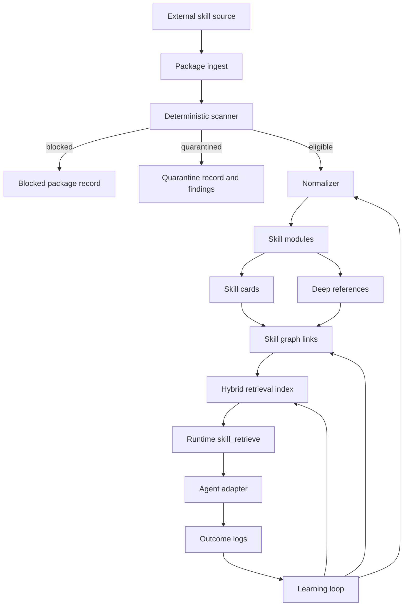

# Skill Intelligence Architecture

## Purpose

Fieldcraft should make external skills useful without turning the agent context into a junk drawer. The system ingests skills from multiple ecosystems, treats them as hostile source material, normalizes them into a shared schema, atomizes large skills when useful, links related concepts into a skill graph, and retrieves only the task-relevant runtime guidance.

This is not a skill installer in the MVP path. It is a local-first skill intelligence layer.

## Core Claims

- Raw public skills are source packages, not runtime payloads.
- Runtime retrieval should return focused skill cards, not full `SKILL.md` files.
- Large skills should be split only when they contain separable activation contexts or procedures.
- Small skills should not be compressed until they lose useful expert detail.
- Related skills should form a typed graph so agents can progressively reveal adjacent guidance.
- Fieldcraft should normalize Codex skills, Claude skills, plugin skills, registry entries, Markdown guides, and official docs into one internal representation.
- Safety status should avoid words like `safe`; use `eligible`, `quarantined`, and `blocked`.

## System Overview



## Concepts

### Source Package

A source package is the immutable-ish record of what Fieldcraft ingested.

Examples:

- Codex `SKILL.md`
- Claude skill folder
- plugin-provided skill
- skill registry entry
- internal Markdown guide
- official documentation page or curated excerpt

Store provenance and scan results here. Do not expose raw package content in normal runtime retrieval.

### Normalized Skill Module

A module is a coherent concept or workflow extracted from one or more source packages. It is larger than a runtime card but smaller than a raw package when the package is broad.

Examples:

- `django-maintainer-bugfix-workflow`
- `pytest-fixtures-markers-plugins`
- `python-property-based-regression-tests`
- `matplotlib-axis-scale-limits`

Modules support review, provenance, and graph organization. A module can emit one or more runtime cards plus optional references.

### Skill Card

A card is the default runtime unit. It must be compact, actionable, separately retrievable, and safe to show without exposing raw package text.

Fields:

```json
{
  "id": "pytest-fixtures-markers-plugins",
  "module_id": "pytest-maintainer-workflows",
  "card_schema_version": 1,
  "normalization_version": "deterministic-v1",
  "content_hash": "sha256:...",
  "atomization_status": "split",
  "title": "Pytest Fixtures, Markers, and Plugin Routing",
  "summary": "Use for bugs involving fixture scope, conftest discovery, marks, skip/xfail, and pytest plugin behavior.",
  "activation_cues": ["fixture scope", "conftest.py", "pytest.mark", "skipif", "xfail", "hookimpl"],
  "negative_cues": ["Django ORM query", "Matplotlib axes", "packaging metadata only"],
  "procedure": [
    "Reproduce with the narrowest pytest invocation.",
    "Identify whether behavior is collection-time, setup-time, call-time, or reporting-time.",
    "Add or adjust a regression test in the closest existing pytest test module.",
    "Verify the changed behavior and one adjacent negative case."
  ],
  "constraints": [
    "Do not introduce broad plugin behavior changes without checking existing hook order tests.",
    "Prefer focused regression tests over global test rewrites."
  ],
  "required_capabilities": ["read repository tests", "run focused pytest command"],
  "verification_steps": ["run the failing test", "run the nearest existing pytest test file"],
  "risk_summary": "Medium risk: pytest changes can affect collection and reporting globally.",
  "source_refs": ["pkg:laurigates/pytest-advanced@026810d"],
  "related_skills": [
    {
      "target_id": "python-regression-test-workflow",
      "relationship": "verification",
      "cue": "Use when the task lacks a regression test or the failure is not isolated."
    }
  ],
  "deep_references": [
    {
      "ref_id": "pytest-hook-ordering-notes",
      "cue": "Open only when hook ordering or plugin precedence is central."
    }
  ]
}
```

Cards are versioned independently from packages. Any mutation to routing cues, procedure text, risk summary, references, or graph links must create a new card revision or a mutation record with before/after state. Package-level hashes are not enough because the normalized card can change while the source package remains pinned.

### Deep Reference

A deep reference is longer supporting material. It can be a distilled excerpt, examples, official docs notes, or source-specific guidance. It is only revealed after a high-confidence card match, an explicit follow-up retrieval, or a policy decision.

Deep references are not full raw source reveal by default.

### Skill Graph

The graph connects cards, modules, and references. Links are typed so the agent can decide whether to follow them.

Link types:

- `prerequisite`: understand this first
- `verification`: use this to prove the fix
- `adjacent`: likely relevant if the task expands
- `risk`: check before finalizing
- `deeper_reference`: open only if compact guidance is insufficient
- `conflict`: avoid combining unless context clearly supports it
- `alternative`: use when this card is close but not quite right

Each edge has:

- source id
- target id
- relationship type
- cue text
- negative cue text
- confidence
- learned weight
- provenance

Edges created during ingest start as pending edges when the target is not yet resolved. A graph integrity pass resolves pending edges after each ingest batch and logs unresolved targets. Runtime retrieval can only traverse resolved edges.

## Ingestion Pipeline

### 1. Package Discovery

Inputs:

- local path
- git checkout
- plugin cache
- registry export
- official docs URL snapshot

Discovery records:

- source URI
- source ecosystem
- source commit/hash
- local canonical path
- detected schema
- license if available
- import timestamp

### 2. Deterministic Validation

Run before LLM use or indexing.

Checks:

- parse frontmatter/body
- canonicalize paths
- reject symlink escapes
- cap file count
- cap file size
- scan Markdown and scripts for prompt injection
- scan for credential reads
- scan for exfiltration patterns
- scan for hidden Unicode
- scan unsafe shell/network patterns
- scan suspicious install commands

Statuses:

- `eligible`: can be normalized and indexed
- `quarantined`: retain package and findings, do not create executable runtime guidance by default
- `blocked`: retain minimal metadata and findings only

Never call a package safe.

### 3. Schema Detection

Detected ecosystems should include:

- `codex_skill`
- `claude_skill`
- `plugin_skill`
- `markdown_guide`
- `registry_card`
- `official_docs_excerpt`
- `unknown`

The detector should preserve source-specific fields but map them into the normalized schema.

Each detected ecosystem receives a normalization policy:

- `heading_split`: deterministic headings are strong enough to propose multiple modules/cards
- `single_card`: source is focused or structure is weak but still eligible
- `manual_review_required`: structure is ambiguous, risky, or too broad for automatic runtime cards
- `skip_runtime`: package can be archived as provenance but should not create runtime cards

Normalization must record parse confidence and selected policy. Low parse confidence must not silently create many cards.

### 4. Normalization

Normalization creates modules, cards, references, and links.

MVP normalization can be deterministic:

- parse title and description
- extract headings
- identify "when to use" and "when not to use"
- identify procedures and commands
- identify verification steps
- identify references
- identify adjacent skills mentioned in source text

LLM-assisted normalization can come later, but only after scanner pass. It must run with no tool use, strict JSON output, bounded input, source provenance, and post-normalization scan.

Normalization failure behavior:

- malformed frontmatter: record finding, use body-only parsing if scan status allows it
- ambiguous structure: create no runtime card or one `atomization_status: "unsplit"` review candidate
- unresolved references: store as pending references, not runtime links
- parse confidence below threshold: send to review queue
- duplicate candidate found: emit duplicate review record before indexing

### 5. Atomization

Atomize a source skill when:

- multiple activation contexts are present
- procedures apply to different task types
- one raw card would match too many unrelated queries
- the source has distinct reference sections
- eval logs show broad false positives
- agents retrieve the same large card but only use one section

Do not atomize when:

- the skill is already focused
- splitting would remove necessary context
- subcards would all share the same activation cues
- the card needs a tightly coupled sequence to be useful

Atomization status values:

- `not_needed`: source is already focused
- `split`: source was split into multiple cards/modules
- `unsplit`: source is broad but automatic splitting was not reliable
- `manual_review_required`: runtime cards should wait for review
- `rejected`: source should not produce runtime guidance

Atomization output:

- module boundaries
- card boundaries
- shared references
- typed graph edges among cards
- negative cues for near-neighbor cards

Atomization should be conservative. A bad split can be worse than one broad card because it creates false confidence. The MVP should prefer `single_card` or `manual_review_required` over speculative splits unless headings, use-cases, and procedures clearly separate.

### 7. Deduplication

Before indexing a new card, compute duplicate candidates against existing cards.

Signals:

- same domain and capability
- overlapping activation cues
- similar procedure keywords
- same source family
- high embedding similarity
- same verification commands

Outcomes:

- `unique`: index normally
- `possible_duplicate`: index only if retrieval budget can collapse duplicates, and add review record
- `duplicate`: keep provenance, do not create a separate runtime card
- `variant`: create a card but add `alternative` or `conflict` edges to near neighbors

Near-duplicate cards should not all be returned in the same response. Reranking should collapse duplicate clusters and choose the highest-quality representative, preserving source provenance from merged/duplicate packages.

### 6. Indexing

Indexes:

- lexical FTS over title, summary, activation cues, negative cues, procedure, source package metadata
- dense embeddings over an embedding text field
- graph index over related skills and references
- risk/trust filters
- project/repo filters
- capability filters

Embedding text should include concise routing content, not the entire source package.

## Runtime Retrieval

### Request

The retrieval API accepts:

- task text
- project id
- repository metadata
- active files or error snippets if available
- requested capabilities
- token budget
- max cards
- reveal policy

### Retrieval Stages

1. Candidate generation with dense + FTS.
2. Eligibility and risk filtering.
3. Project and capability filtering.
4. Near-neighbor reranking using activation and negative cues.
5. Graph expansion for a small number of typed related hints.
6. Budget allocation.
7. Return cards with confidence labels and optional follow-up link hints.

### Confidence Behavior

- Low confidence: return no skill.
- Medium confidence: return compact top cards only.
- High confidence: return top card plus runner-up summaries and typed related-skill hints.
- Very high confidence plus explicit need: allow deep reference reveal.

Default max cards: 3.

Raw full `SKILL.md` reveal is excluded from the MVP default path.

Confidence bands are calibrated numeric thresholds, not hardcoded labels. Thresholds are model/index-version specific and must be evaluated on a labeled held-out set before being used for claims.

Empty retrieval responses include a reason:

- `no_candidates`: no card matched at candidate-generation stage
- `below_threshold`: candidates existed but all scored below calibrated threshold
- `all_filtered`: candidates existed but were blocked by eligibility, project, capability, or risk policy
- `budget_excluded`: plausible candidates existed but were excluded by token budget

This distinction matters because the caller can react differently: acquire skills, ask for more context, adjust filters, or proceed without skills.

### Runtime Output Shape

```json
{
  "query": "fix failing pytest caplog behavior with skipped unittest case",
  "cards": [
    {
      "id": "pytest-fixtures-markers-plugins",
      "confidence": "high",
      "score": 0.86,
      "title": "Pytest Fixtures, Markers, and Plugin Routing",
      "summary": "...",
      "activation_reason": "matched caplog, skipped unittest, pytest reporting behavior",
      "guidance": ["..."],
      "verification_steps": ["..."],
      "risk_summary": "...",
      "related_hints": [
        {
          "target_id": "python-regression-test-workflow",
          "relationship": "verification",
          "cue": "Open if you need to write or narrow the regression test."
        }
      ]
    }
  ],
  "omitted": {
    "no_skill_reason": null,
    "low_confidence_count": 12,
    "blocked_count": 3,
    "budget_excluded_count": 4
  }
}
```

## Adapters

Fieldcraft stores a neutral internal schema and renders ecosystem-specific views.

Adapters:

- Codex runtime card renderer
- Claude `SKILL.md` exporter
- MCP `skill_retrieve`
- registry/catalog JSON
- eval harness JSONL

Adapters should not own safety, provenance, or ranking logic. They only render a policy-approved view of normalized artifacts.

## Storage Model

Tables:

- `skill_packages`
- `skill_package_files`
- `skill_findings`
- `skill_modules`
- `skill_cards`
- `skill_card_revisions`
- `skill_card_mutations`
- `skill_references`
- `skill_edges`
- `skill_pending_edges`
- `skill_duplicate_candidates`
- `skill_embeddings`
- `skill_retrieval_log`
- `skill_usage_feedback`
- `skill_mutation_proposals`
- `skill_eval_runs`
- `skill_eval_labels`

Important fields:

- package hash
- source ecosystem
- source URI
- license
- scan status
- risk status
- normalization version
- card schema version
- card content hash
- atomization status
- source provenance per card/module/reference
- learned edge weights
- graph resolution status
- duplicate cluster id
- retrieval scores and omission reasons
- outcome labels when available

### Quarantine Promotion

Quarantine is not a soft warning. A quarantined package cannot produce runtime guidance unless it is promoted through an explicit process.

Promotion requires:

- operator or process id
- timestamp
- rationale
- finding ids addressed or accepted
- rescan hash
- `rescan_confirmed: true`
- resulting status

Promotion records are append-only. A package must pass scanner status `eligible` after the promotion decision before normalization is unlocked.

## Learning Loop

Signals:

- card retrieved
- card shown
- card ignored
- linked card opened
- linked card ignored
- patch succeeded
- patch failed
- task solved faster/slower
- token use changed
- agent explicitly cited skill
- human accepted/rejected result

Actions:

- strengthen activation cues
- add negative cues
- split broad cards
- merge cards used together
- strengthen or weaken graph edges
- quarantine or demote risky cards
- update project-specific priors
- identify missing skill families

Learning must be auditable. Keep automatic changes versioned and reversible.

Learning loop actions are proposals first, not direct writes to production retrieval state.

Proposal classes:

- low risk: add negative cue, weaken edge, lower card priority
- medium risk: add activation cue, strengthen edge, add related hint
- high risk: split card, merge cards, promote quarantined content, change reveal policy

Only low-risk proposals can be auto-applied, and only when supported by repeated outcome evidence. Medium-risk proposals require batch review or stricter thresholds. High-risk proposals require human review or an explicitly configured policy gate.

Every proposal records:

- signal source
- evidence count
- before/after diff
- affected cards/edges
- expected retrieval effect
- rollback pointer
- approval status

## Evaluation

Retrieval evals:

- precision@1
- precision@3
- recall@3
- no-skill precision for unrelated tasks
- near-neighbor confusion rate
- graph-follow usefulness
- blocked/quarantined leakage rate
- duplicate cluster return rate

Task outcome evals:

- solve rate
- wall time
- input tokens
- output tokens
- reasoning tokens when available
- number of tool calls
- number of test runs
- non-empty patch rate

Benchmark tiers:

- cold
- memory only
- skill only
- memory + skill

For a public claim, use frozen corpus, frozen model, preregistered task set, multiple repos, multiple reruns, official harness, confidence intervals, and significance tests.

Eval labels must be independent from the card generation path.

Label sources:

- `human`: manually labeled query-card relevance
- `outcome_log`: card shown or followed in a task that later passed, with caveats
- `heuristic`: generated from metadata, useful for development only

Only `human` and carefully qualified `outcome_log` labels can support headline metrics. Heuristic labels cannot support public precision/recall claims because they can encode the same activation cues used by retrieval.

For no-skill precision, include adversarial near-neighbor queries that should return nothing or a different card. For graph usefulness, measure whether following links improves outcome or only increases context.

## Product Surface

CLI:

- `fieldcraft skills scan --source <path>`
- `fieldcraft skills ingest --source <path>`
- `fieldcraft skills normalize <package-id>`
- `fieldcraft skills query "<task>" [--project <id>]`
- `fieldcraft skills graph <skill-id>`
- `fieldcraft skills explain <skill-id>`
- `fieldcraft skills eval ...`

MCP:

- `skill_retrieve`
- `skill_follow_link`
- `skill_explain_retrieval`

UI later:

- skill package inventory
- scan findings
- normalized card review
- graph browser
- retrieval traces
- eval dashboard

## MVP Scope

Include:

- local path ingestion
- deterministic validation
- deterministic normalization for common `SKILL.md` structures
- skill cards
- typed related-skill hints
- dense + FTS retrieval
- MCP `skill_retrieve`
- retrieval logs
- benchmark JSONL export

Exclude:

- hosted registry sync
- raw full source reveal
- automatic execution of skill scripts
- trust marketplace
- unreviewed LLM normalization
- automatic self-modifying production graph changes

## Open Risks

- Public skills may be low quality, malicious, stale, or license-incompatible.
- Over-atomization can remove useful context.
- Under-atomization can create broad false positives.
- Graph expansion can reintroduce context bloat if not budgeted.
- Evaluation can overfit if task-family cards are derived too directly from benchmark tasks.
- Adapters can accidentally leak source-specific instructions if rendering policy is weak.
- "Skill helped" is hard to attribute unless logging distinguishes retrieval, reveal, usage, and outcome.
- Learned graph changes can be poisoned if outcome signals are weak or attacker-controllable.
- Duplicate cards can inflate apparent recall and waste runtime budget.
- Quarantine can become meaningless if override and promotion paths are not enforced.

## Design Principle

Fieldcraft should behave like a compiler and retrieval engine for agent skills:

1. ingest messy source material,
2. validate it,
3. normalize it,
4. split or preserve structure based on evidence,
5. link concepts into a graph,
6. retrieve focused runtime guidance,
7. learn from outcomes.
