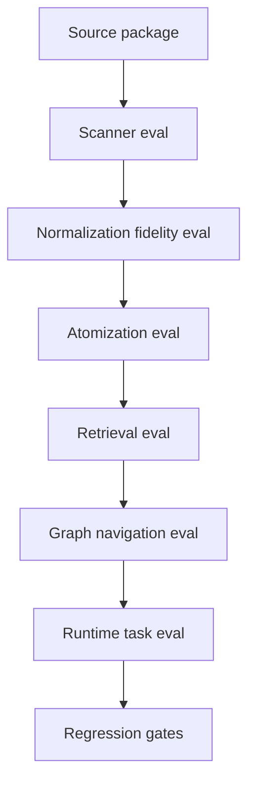

# Skill Normalization Evaluation Framework

## Purpose

Every ingested skill package should be evaluated after scanning and normalization. The goal is not just "did we parse it" but "did we preserve the useful expertise in a safer, more retrievable shape?"

The eval framework answers:

- Did normalization preserve the source skill's useful intent?
- Did atomization split at the right boundaries?
- Did we lose important constraints, warnings, examples, or verification steps?
- Did we introduce unsafe instructions or leak quarantined content?
- Does retrieval find the right normalized card for realistic tasks?
- Does graph navigation reveal useful adjacent guidance without bloating context?
- Is the normalized output better than showing the raw skill, under the same budget?

## Evaluation Levels



## Level 1: Scanner Eval

Scanner eval verifies that hostile or risky source material is classified before any runtime card is created.

Checks:

- known prompt-injection fixtures are flagged
- hidden Unicode fixtures are flagged
- credential access fixtures are flagged
- `curl | sh`, unsafe install, exfiltration, and shell/network fixtures are flagged
- benign skills remain eligible
- quarantined and blocked packages produce no runtime executable guidance

Metrics:

- malicious fixture recall
- benign fixture false-positive rate
- blocked/quarantined runtime leakage rate
- finding evidence quality

Gate:

- blocked/quarantined leakage must be zero
- malicious fixture recall must meet a strict threshold before ingestion release

## Level 2: Normalization Fidelity Eval

This asks whether the normalized cards preserve the source skill's expert content.

Inputs:

- raw source skill
- normalized modules/cards/references
- source-derived gold checklist
- optional human reviewer notes

Gold checklist fields:

- core intent
- primary use cases
- negative use cases
- required prerequisites/capabilities
- essential steps
- essential warnings/constraints
- important examples or patterns
- verification steps
- source references/provenance

Metrics:

- intent preservation
- essential-step coverage
- warning/constraint coverage
- verification coverage
- differentiating-content preservation
- provenance coverage
- unsafe-content exclusion
- unsupported-claim introduction rate
- compression ratio
- post-normalization scanner pass rate

Procedure:

1. Extract a source checklist with an evaluator path that is independent from the normalizer.
2. Use an adversarial checklist prompt that explicitly hunts for constraints, negative use cases, non-obvious caveats, examples, and warnings.
3. Compare the checklist against normalized cards.
4. Run the scanner again on normalized cards, references, edge cues, and adapter-rendered payloads, not only on the source package.
5. Fail normalization if a required step, warning, differentiating detail, or verification path is missing.
6. Flag review if normalized guidance introduces claims not grounded in source or approved references.

The checklist generator and the normalizer must not be the same code path. If the same model is used, the prompts and execution path must be separate and the checklist prompt must be adversarial. Otherwise systematic omissions can become invisible.

Important distinction:

- "Shorter" is not automatically better.
- A card can be compact and still preserve high-value examples, warnings, and verification steps.
- A card that removes the thing that makes the skill expert is a failed normalization even if retrieval improves.

### Differentiating-Content Probe

To detect watered-down skills, extract the 2-5 most non-obvious pieces of source expertise:

- exact version caveats
- platform-specific warnings
- "do this, not that" guidance
- uncommon failure modes
- specialized commands or verification patterns
- subtle negative cues
- examples that distinguish the skill from generic model knowledge

The normalized output must preserve these details when they are relevant to runtime use. A card that replaces a specialized skill with generic best practices fails even if it covers the broad intent.

### Post-Normalization Safety Pass

Every normalized card, reference, edge cue, and adapter-rendered payload must be scanned before indexing.

This catches:

- paraphrased dangerous commands
- prompt-injection instructions introduced or preserved by normalization
- unsafe examples moved from source into card text
- source-specific tool instructions that should not be executable at runtime
- hidden Unicode or encoded payloads introduced during transformation

## Level 3: Atomization Eval

This tests whether large skills were split correctly.

Failure modes:

- over-splitting: cards are too thin, require hidden context, or always co-occur
- under-splitting: broad cards match unrelated tasks and crowd out better cards
- wrong boundaries: one procedure is split across cards that cannot stand alone
- duplicate splitting: multiple cards say the same thing with different names
- missing cross-links: split cards need each other but graph edges are absent

Metrics:

- card self-sufficiency score
- co-retrieval rate
- co-usage rate
- near-neighbor confusion rate
- duplicate cluster rate
- missing-edge rate
- overbroad match rate

Tests:

- one positive query per proposed card
- one negative query per near-neighbor card
- one integration query that should retrieve multiple linked cards
- one unrelated query that should retrieve no card
- one "raw source name removed" query that describes the task without naming the skill
- one standalone task probe where only the candidate card is available
- one breadth probe across distinct subtopics found in the card

Heuristics:

- If two cards are retrieved together in most positives and neither works alone, consider merging.
- If one card wins many unrelated positives, split or add negative cues.
- If a task starts at one card and reliably needs another, add a typed edge.
- If several cards differ only by phrasing, deduplicate.

Primary self-sufficiency signal is task completion with the candidate card in isolation, not co-retrieval. Co-retrieval is only a proxy. For a new package with little usage data, use synthetic or benchmark-like execution probes where the agent receives only one candidate card and must solve or plan the task.

### Topic Breadth Probe

Under-splitting is detected by measuring whether one card has multiple unrelated query clusters.

Procedure:

1. Extract distinct subtopics from the card body.
2. Generate positive and negative queries for each subtopic.
3. Embed and cluster the queries.
4. If one card strongly matches several distinct clusters with different procedures or verification paths, flag `needs_reatomization`.

A healthy card should have one dominant intent cluster. Multi-cluster cards are allowed only when the procedure is genuinely shared and negative cues prevent adjacent misrouting.

## Level 4: Retrieval Eval

This checks whether normalized cards are discoverable at runtime.

Query classes:

- explicit task queries
- redacted task queries with skill names removed
- realistic session snippets
- error messages and stack traces
- repository-specific issue statements
- near-neighbor adversarial queries
- unrelated no-skill queries

Metrics:

- precision@1
- precision@3
- recall@3
- mean reciprocal rank
- no-skill precision
- near-neighbor confusion
- low-confidence abstention quality
- duplicate cluster return rate
- token budget fit rate

Gate:

- no blocked/quarantined card may be returned
- no raw source reveal
- duplicate clusters must collapse in top-k
- low confidence should abstain rather than guess

## Level 5: Graph Navigation Eval

This evaluates typed links after the initial card is retrieved.

Questions:

- Are related hints useful and specific?
- Do links point to real resolved cards/references?
- Does following the link improve solve rate or only add context?
- Do risk links prevent bad patches?
- Do verification links improve tests?

Metrics:

- link precision
- link follow usefulness
- dead-edge rate
- graph bloat rate
- verification-link outcome lift
- risk-link defect reduction

Gate:

- dead-edge rate must be zero for runtime-visible links
- graph bloat rate above threshold disables graph expansion for that package
- low link precision changes package decision to `eligible_card_only`

Test setup:

- card-only baseline
- card plus related hints
- card plus followed links
- raw source baseline under equal token budget

## Level 6: Runtime Task Eval

This measures whether normalized skills improve real work.

Tiers:

- cold
- raw skill under same budget
- normalized card only
- normalized card plus graph hints
- normalized card plus followed references
- memory only
- memory + normalized skill

Metrics:

- solve rate
- wall time
- input tokens
- output tokens
- reasoning tokens when available
- tool calls
- test runs
- patch size
- regression test quality
- non-empty patch rate
- reviewer acceptance

Runtime regression gates:

- solve rate drop above configured threshold versus pinned baseline blocks rollout
- token increase above configured threshold with no solve-rate lift requires review
- wall-time increase above configured threshold with no solve-rate lift requires review
- normalized-card tier performing worse than cold on paired tasks requires review
- unsafe leakage, raw source reveal, or blocked card retrieval blocks rollout
- graph-hints tier worse than card-only disables graph expansion until fixed

For public claims:

- preregister task set
- freeze model
- freeze corpus
- freeze retrieval thresholds
- use official harness where possible
- run multiple seeds/reruns
- use paired analysis
- report confidence intervals and significance tests

## Normalization Quality Scorecard

Each normalized package receives a scorecard:

```json
{
  "package_id": "pkg:laurigates/pytest-advanced@026810d",
  "normalization_version": "deterministic-v1",
  "scanner": {
    "status": "eligible",
    "blocked_runtime_leakage": 0
  },
  "fidelity": {
    "intent_preservation": 0.95,
    "essential_step_coverage": 0.91,
    "warning_coverage": 0.86,
    "verification_coverage": 1.0,
    "differentiating_content_preservation": 0.9,
    "unsupported_claim_rate": 0.0,
    "post_normalization_scanner_pass": true
  },
  "atomization": {
    "status": "split",
    "self_sufficiency": 0.84,
    "near_neighbor_confusion": 0.06,
    "duplicate_cluster_rate": 0.0,
    "missing_edge_rate": 0.08,
    "standalone_task_success": 0.78,
    "topic_cluster_count": 1
  },
  "retrieval": {
    "query_count": 80,
    "precision_at_1": 0.88,
    "recall_at_3": 0.94,
    "no_skill_precision": 0.97,
    "budget_fit_rate": 1.0
  },
  "graph": {
    "link_eval_count": 40,
    "link_precision": 0.82,
    "dead_edge_rate": 0.0,
    "graph_bloat_rate": 0.04
  },
  "decision": "eligible_for_runtime",
  "required_actions": []
}
```

Decisions:

- `eligible_for_runtime`
- `eligible_card_only`
- `needs_review`
- `needs_reatomization`
- `needs_deduplication`
- `quarantine_runtime`
- `blocked`

## Runtime Gates

Before a normalized package can be used by `skill_retrieve`, require:

- scanner status is `eligible`
- no blocked/quarantined runtime leakage
- card content hash exists
- graph integrity pass succeeds or unresolved edges are hidden
- duplicate clusters are resolved or collapsed
- fidelity eval passes required checklist items
- retrieval eval has at least minimal positive and negative coverage
- normalized cards and adapter payloads pass scanner
- differentiating-content probe passes
- retrieval metrics meet minimum sample size requirements

Minimum sample sizes:

- package smoke: at least 5 positive and 5 negative retrieval queries
- runtime eligible: at least 20 total retrieval queries including near-neighbor negatives
- calibrated thresholds: at least 50 labeled queries for the relevant domain or package family
- public claim: preregistered benchmark-sized task set, not package-local synthetic queries

For high-risk packages:

- require human review
- disable deep references by default
- disable graph expansion until link eval passes

## Continuous Regression

Run normalization eval:

- after ingest
- after scanner changes
- after normalizer changes
- after embedding/ranking changes
- after learning-loop mutation proposals
- before benchmark runs
- before public claims

Regression outputs:

- changed cards
- changed hashes
- changed routing scores
- changed graph edges
- changed eval metrics
- new duplicate candidates
- new unsafe findings

Any runtime-visible card change should be explainable by diff.

## Metric Hygiene

Metrics that do not affect a decision should not be shown as headline quality signals.

Compression ratio is diagnostic only:

- extreme compression triggers fidelity re-review
- extreme expansion triggers runtime budget review
- normal compression does not imply quality

Reviewer acceptance must use a structured rubric:

- core intent preserved
- essential warnings preserved
- non-obvious expertise preserved
- no unsupported claims
- no unsafe runtime guidance
- split boundaries make sense
- retrieval examples are realistic

Each criterion is pass/fail with notes.

## Core Principle

Normalization is successful only when the normalized skill is:

1. safer than the raw source,
2. easier to retrieve,
3. small enough for runtime use,
4. rich enough to preserve expert value,
5. linked well enough to recover necessary depth,
6. measurably helpful on realistic tasks.
